# 配送管理システム オペレーションマニュアル

最終更新: 2026-10-15

## この文書について

本書は、配送管理システムを日常業務で使う方向けの操作マニュアルです。開発・保守向けの技術仕様は `docs/仕様書.md` を参照してください。画面の画像は説明用のテストデータで撮影しています。

本書は4部構成です。ご自身の権限に合わせてお読みください。

| 部 | 読む方 | 内容 |
|---|---|---|
| 第1部 | すべての方 | ログイン、ダッシュボード、荷物受付、配送計画一覧、リアルタイム追跡 |
| 第2部 | 配送管理者・システム管理者 | 稼働トラックの登録、荷物受付状況の確認、配送計画の作成、稼働後の変更 |
| 第3部 | システム管理者 | ドライバー・トラック・配送先・商品・ユーザーの管理、システム設定 |
| 第4部 | ドライバー | スマートフォンでの配送の操作 |

### 権限と使える画面

| 権限 | 使える画面 |
|---|---|
| 一般ユーザー | ダッシュボード、荷物受付、配送計画一覧、リアルタイム追跡 |
| 配送管理者 | 上記に加えて、配送計画の作成、稼働トラックの登録、荷物受付状況の確認 |
| システム管理者 | 上記に加えて、マスタ管理（ドライバー・トラック・配送先・商品・ユーザー）、システム設定 |

権限のない画面はサイドバーに表示されません。

### 1日の業務の流れ

| 順番 | 作業 | 担当 | 画面 |
|---|---|---|---|
| 1 | その日に使うトラックとドライバーを登録する | 配送管理者 | 稼働トラックの登録 |
| 2 | 届ける配送先と荷物を登録する | 一般ユーザー以上 | 荷物受付 |
| 3 | 配送先をトラックに割り当てる | 配送管理者 | 配送計画の作成 |
| 4 | ドライバーにURLを送る | 配送管理者 | 配送計画一覧 |
| 5 | 配送する | ドライバー | ドライバー用画面（スマートフォン） |
| 6 | 進み具合を確認する | 一般ユーザー以上 | ダッシュボード、リアルタイム追跡 |
| 7 | 出発後に受け付けた配送先を追加する | 配送管理者 | 荷物受付 → 稼働後ルートの編集 |

---

# 第1部 すべての方向け

## 1. ログイン・ログアウト

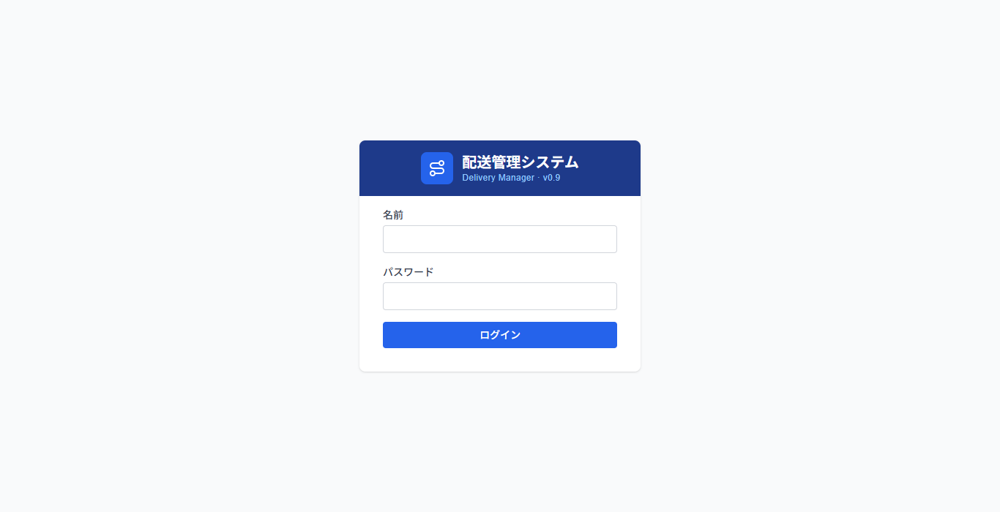

1. ブラウザでシステムのURLを開くと、ログイン画面が表示されます。
2. **名前**と**パスワード**を入力し、「ログイン」を押します。名前はユーザー管理で登録された名前です（メールアドレスではありません）。
3. ログインすると、ダッシュボードが表示されます。ログイン前に別の画面のURLを開いていた場合は、その画面に戻ります。

名前またはパスワードが違う場合は「名前またはパスワードが正しくありません」と表示されます。

ログアウトするには、サイドバー左下の「ログアウト」を押します。

## 2. 画面の見方

画面左側のサイドバーから各画面に移動します。

サイドバーの一番上にある青い「荷物を受け付ける」ボタンを押すと、荷物受付の画面が開きます。荷物受付は、一般ユーザーが配送先・荷物を登録する画面のため、ほかのメニューとは分けてボタンにしています。荷物受付の画面を開いている間は、ボタンに枠が付きます。

その下のメニューは3つの区分に分かれています。

| 区分 | 画面 |
|---|---|
| 業務メニュー | ダッシュボード、配送計画一覧、リアルタイム追跡 |
| 配送管理メニュー | 配送計画の作成、稼働トラックの登録、荷物受付状況の確認 |
| マスタ管理メニュー | ドライバー管理、トラック管理、配送先管理、商品管理、ユーザー管理、システム設定 |

ボタンやメニューの右側の数字は、確認が必要な件数です。

- **荷物を受け付ける**（白地に青い数字）: 今日の配送先のうち、まだトラックに割り当てられていない配送先の数
- **荷物受付状況の確認**（赤）: 容積や時間に注意が必要な日の数

日付を表示する画面では、日付の横に「今日」「明日」「◯日後」「◯日前」の目印が表示されます。

## 3. ダッシュボード

その日の配送の状況をひと目で確認する画面です。

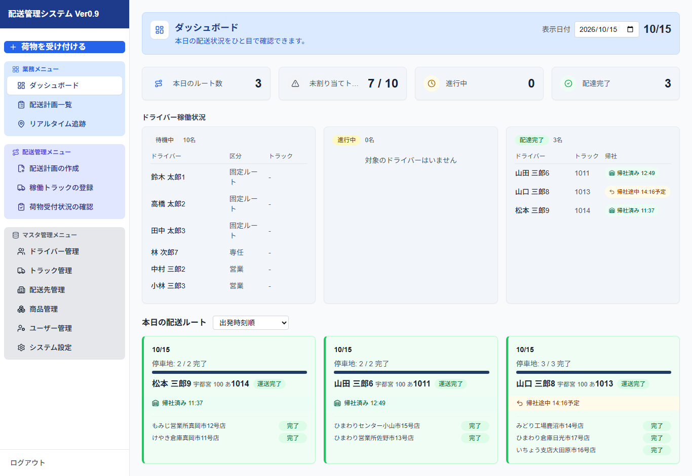

- **表示日付**: 右上で日付を切り替えられます。「今日に戻す」で今日に戻ります。
- **上段の数字**: その日のルート数、トラックが割り当てられていないトラック数（全台数のうち）、進行中、配達完了のルート数です。
- **ドライバー稼働状況**: ドライバーを「待機中」「進行中」「配達完了」に分けて表示します。
  - 進行中のドライバーには、何便目かを示す「2/2便」のような目印が付きます。
  - 「配達完了」の欄は、ドライバー・トラック・帰社の状況を1行に表示します。
    - **帰社途中 14:16予定**（オレンジ）: 配達はすべて終わり、本社へ戻っている途中です。時刻は本社に着く見込みです。
    - **帰社済み 11:37**（緑）: 本社に戻り、ドライバーが「帰社」を押した時刻です。
- **本日の配送ルート**: トラックごとのカードで、配送先ごとの状況（完了・未完了）と便を表示します。上の並び替えで、出発時刻順・配送状況順などに切り替えられます。
  - 配達が終わったトラックのカードには、同じ「帰社途中」「帰社済み」が帯で表示されます。

帰社予定の時刻は、最後に配達を完了した時刻と場所から、本社までの移動時間（昼休みを含む）で計算した目安です。配送計画一覧の「帰社予定」は計画上の予定時刻から計算するため、時刻が違うことがあります。

## 4. 荷物受付

その日に「どこに」「何を」届けるかを登録する画面です。ここではトラックへの割当は行いません（割当は配送管理者が「配送計画の作成」で行います）。

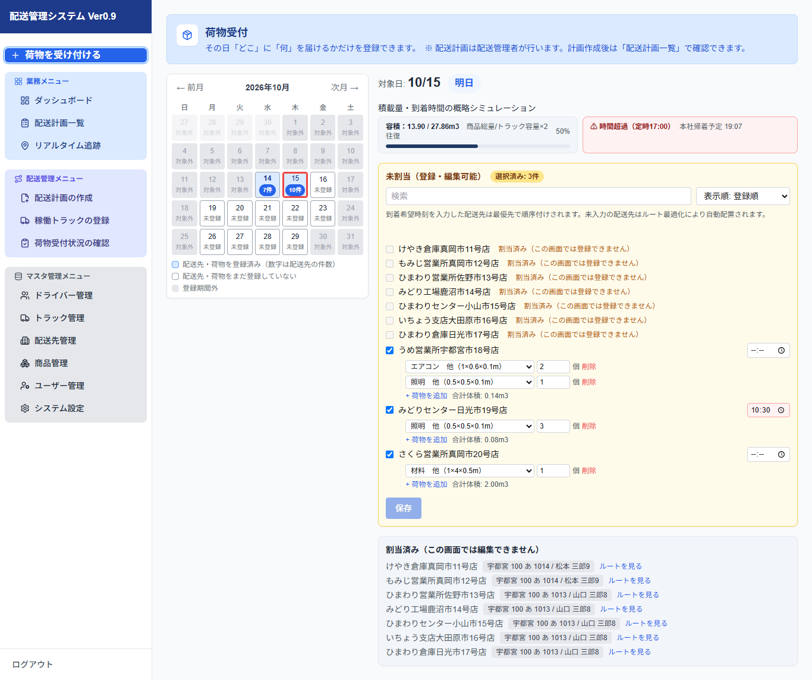

### 4.1 配送先と荷物を登録する

1. 左のカレンダーで配送日を選びます。数字の付いた日は、すでに登録がある日です（数字は配送先の件数）。
2. 「未割当（登録・編集可能）」の一覧から、届ける配送先にチェックを入れます。上の検索欄で絞り込めます。
3. チェックを入れると、その下に荷物の入力欄が出ます。商品を選び、個数を入力します。荷物が複数ある場合は「＋荷物を追加」を押します。
4. お客様と到着時刻の約束がある場合は、右側の時刻欄に到着希望時刻を入力します。
5. 「保存」を押します。

登録できるのは、今日以降で、トラックが1台以上登録されている日だけです。カレンダーで「対象外」と表示される日は登録できません。

### 4.2 画面上部の見込み

- **容積**: その日に登録した荷物の体積の合計と、登録されたトラックで運べる量（往復回数と、システム設定の積載利用率を見込んだ量）を比べます。
- **時間**: 登録した内容をすべて配りきった場合に、定時（設定の運送終了時間）までに本社へ戻れるかの見込みです。間に合わない場合は「時間超過」と表示されます。

どちらも目安です。実際の割当は配送管理者が行います。

### 4.3 編集できない配送先

- **割当済み**: すでにトラックに割り当てられた配送先です。この画面では変更できません。下の「割当済み」に、割当先のトラックが表示されます。
- **分割済み**: 1台に積みきれず、配送管理者が2つに分けた配送先です。この画面では変更できません。

### 4.4 ほかの人と同時に編集した場合

荷物受付は、何人でも同時に使えます。別々の配送先を登録・編集している限り、全員の保存がそのまま反映されます。

自分が画面を開いた後に、他の人が**同じ配送先**を先に変更・保存していた場合だけ、その配送先の自分の変更は保存されません。「○○さんが先に更新していたため、この配送先の変更は保存されませんでした」と、誰が変更したかが表示されます。

- 「確認しました」を押すと、画面は自動で最新の内容（相手が保存した内容）に切り替わります。ブラウザの再読み込みやログアウトは必要ありません。
- 保存されなかった配送先の内容を確かめ、必要なら入力し直して、もう一度「保存」を押してください。
- 同じ保存で変更した他の配送先は、保存されています。
- 他の人が新しく登録した配送先は、自分の画面には自動では表示されません。保存したときや、画面を開き直したときに表示されます。

## 5. 配送計画一覧

その日の全トラックの予定と進み具合を、時間軸の図（配車表）で確認する画面です。

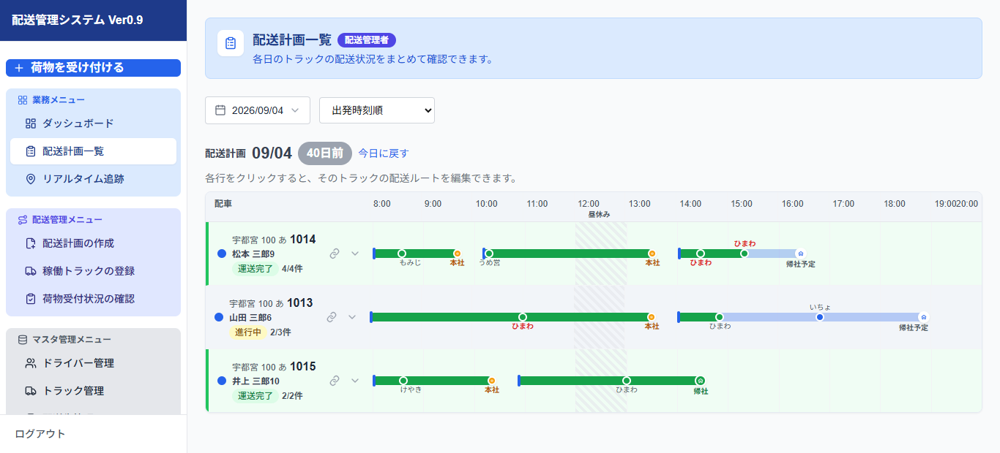

- 左上で日付と並び順を切り替えます。
- 1行が1台のトラックです。左側にナンバー、ドライバー、運行状況、完了件数が表示されます。
- 右側の図の見方
  - **緑の線**: 終わった区間
  - **薄い青の線**: これからの予定
  - **丸印**: 配送先（下に配送先名の先頭が表示されます。赤字は到着時刻の約束がある配送先）
  - **本社（オレンジの丸）**: 便の区切りで本社に戻って積み込む地点
  - **家の印**: 帰社。実際に帰社したものは「帰社」、予定は「帰社予定」と表示されます
  - **斜線の帯**: 昼休み
- 印にマウスを重ねると、時刻などの詳細が表示されます。

行の「∨」を押すと、その日に届ける荷物の一覧が開きます。同じ商品は「×個数」でまとめて表示されます。

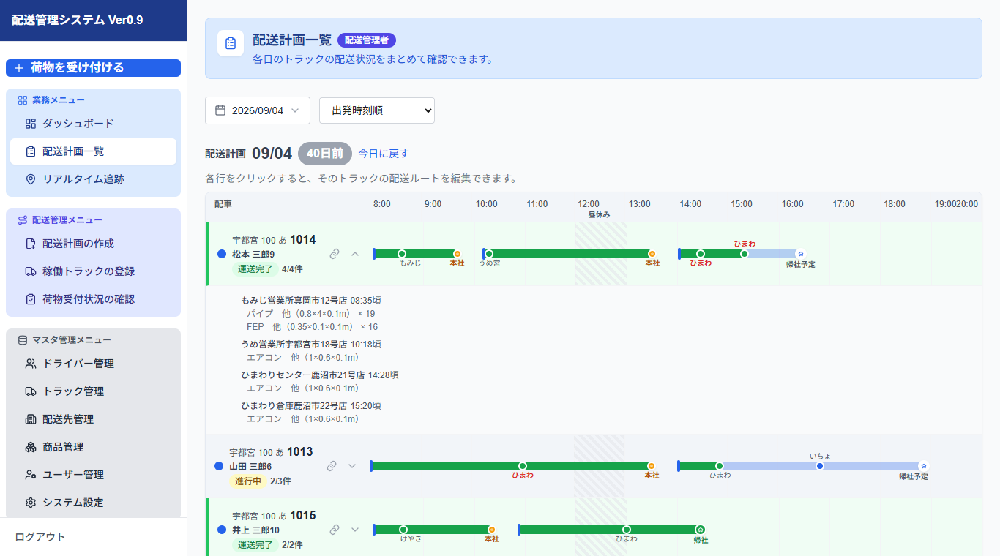

鎖の印（🔗）は、ドライバー用URLのコピーです（11章）。行をクリックすると、そのトラックの配送計画の編集画面に移ります（配送管理者以上）。

## 6. リアルタイム追跡

今日の各トラックの位置と進み具合を確認する画面です。

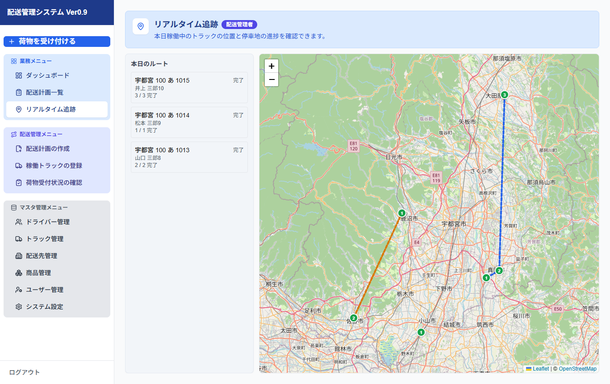

- 左側に今日のルートが一覧表示されます（15秒ごとに自動で更新）。
- 地図には、配送先（番号付きの丸）と、ドライバーのスマートフォンから送られてきたトラックの現在地（🚚）が表示されます。トラックの位置は自動で動きます。
- 一覧のルートや地図のトラックを押すと、そのルートの配送先の状況が表示されます。

### ドライバーの押し忘れを本部で直す

ドライバーが「運送開始」「完了」「帰社」などを押し忘れた場合、この画面から本部が代わりに操作できます（配送管理者以上。一般ユーザーは見るだけです）。代わりに操作したものは、ドライバーの画面に「（本部による操作）」のように表示されます。

---

# 第2部 配送管理者向け

## 7. 稼働トラックの登録

配送日ごとに、使うトラックとドライバーの組み合わせを登録します。配送計画づくりの最初の作業です。

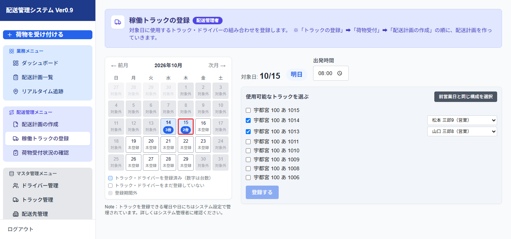

1. 左のカレンダーで配送日を選びます。数字の付いた日は、登録済みの台数です。
2. 「使用可能なトラックを選ぶ」で、使うトラックにチェックを入れます。トラックにデフォルトのドライバーが設定されていれば、自動で入ります。
3. ドライバーを確認・変更し、必要なら出発時間を変えます。
4. 「登録する」を押します。

- **前営業日と同じ構成を選択**: 前の営業日と同じトラック・ドライバーを一度に選べます。
- ドライバーが休日の日や、同じドライバーを2台に割り当てた場合は、エラーが表示されて登録できません。
- 登録できる日の範囲（何日先まで、土日・祝日を除くか）は、システム設定で決まります。
- チェックを外したトラックに配送先が割り当てられていた場合、その配送先は削除されず、未割当に戻ります。
- すでに出発したトラックは、この画面では変更できません。

## 8. 荷物受付状況の確認

今日から先の数日分について、荷物の量と時間に問題がないかを一覧で確認する画面です。

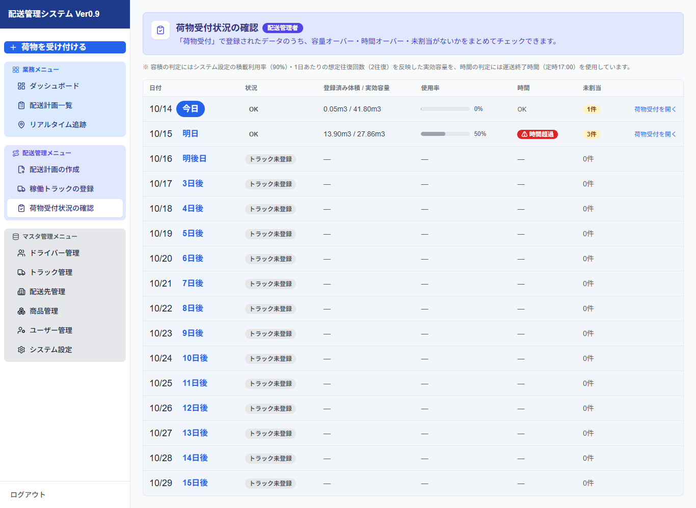

| 列 | 内容 |
|---|---|
| 状況 | トラックが未登録の日は「トラック未登録」 |
| 登録済み体積 / 実効容量 | 荷物の体積の合計と、運べる量 |
| 使用率 | 80%以上で注意の色になります |
| 時間 | 定時までに配りきれない見込みなら「時間超過」 |
| 未割当 | まだトラックに割り当てていない配送先の件数 |

「荷物受付を開く」で、その日の荷物受付画面に移ります。

## 9. 配送計画の作成（出発前）

未割当の配送先を、各トラックに割り当てる画面です。割り当てると、配送の順番と到着予定時刻が自動で計算されます。

### 9.1 配送日を選ぶ

サイドバーの「配送計画の作成」を押すと、カレンダーが表示されます。配送日を選び、「トラックに配送先・荷物を割当てる」を押します。

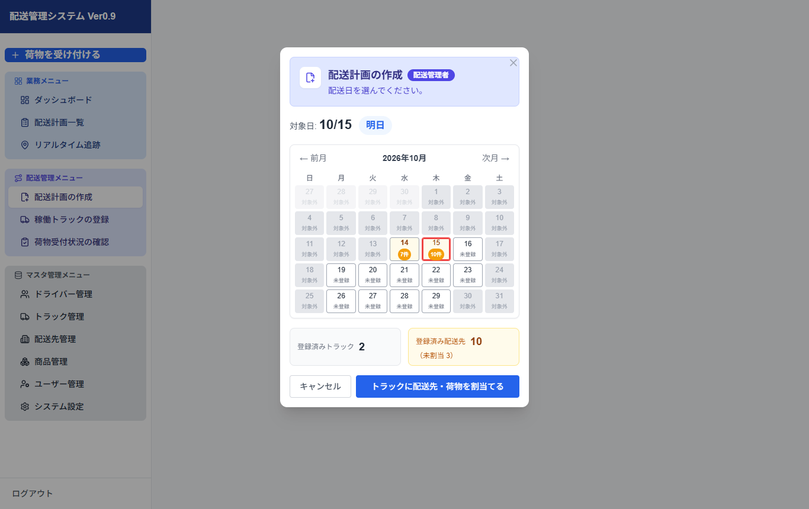

カレンダーの数字は、その日の配送先の件数です。オレンジは、まだ割り当てていない配送先がある日です。選んだ日のトラックがすべて出発済みの場合は、配送計画一覧へ案内されます。

### 9.2 画面の見方

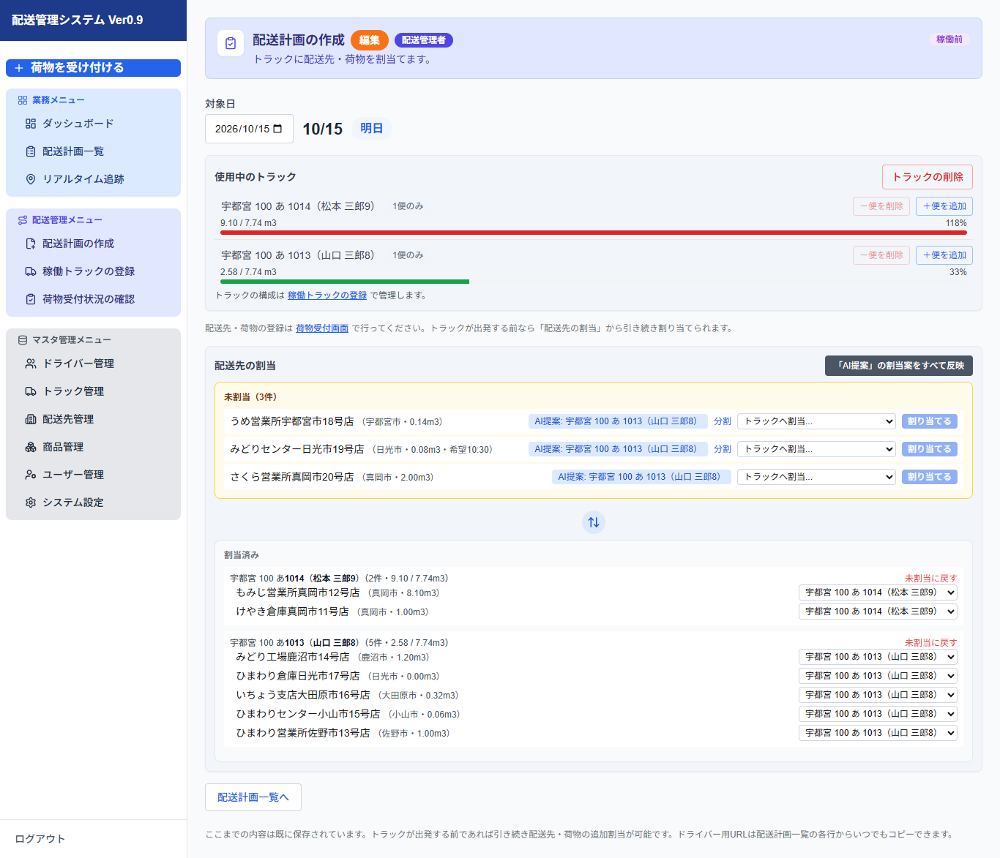

- **使用中のトラック**: その日のトラックと、積んでいる量（m³）・積載率です。積める量は「容積上限×積載利用率（システム設定）」で、これを100%とします。積みすぎ（100%超）は赤で表示されます。
- **配送先の割当**: 上が「未割当」、下が「割当済み」です。

### 9.3 配送先を割り当てる

1. 「未割当」の配送先の右にある「トラックへ割当...」で、トラック（と便）を選びます。
2. 「割り当てる」を押します。割当済みの一覧に移り、順番と到着予定時刻が計算し直されます。

割当済みの配送先は、右側のプルダウンで別のトラックへ移せます。「未割当に戻す」で未割当に戻せます。

### 9.4 AI提案を使う

未割当の配送先には「AI提案: ◯◯」として、おすすめのトラックが表示されます。同じ方面の配送先をまとめ、特定のトラックに偏らないように選ばれます。

- 「『AI提案』の割当案をすべて反映」を押すと、未割当の配送先をおすすめどおりに一度に割り当てます。
- AI提案はあくまで参考です。反映した後も、個別に変更できます。
- 荷台に入らない荷物は「サイズ超過」、空きがない場合は「容積不足」と表示されます。
- AI提案は、すでにある便の中でだけ振り分けます。足りない場合は、先に「＋便を追加」で便を増やしてください。

手動で割り当てる場合は、容積やサイズのチェックはされません。積みすぎに注意してください。

### 9.5 便を増やす・減らす

1台のトラックが本社に戻って積み直し、もう一度配送に出ることを「便」と呼びます。

- 「＋便を追加」で便を増やします。割当のプルダウンで「1便」「2便」を選べるようになります。
- 「－便を削除」で最後の便を削除します。配送先が割り当てられている便や、最後の1便は削除できません。

### 9.6 配送先を分割する

1つの配送先の荷物が1台に積みきれない場合は、分割して2台に分けて運べます。荷物が2個以上ある未割当の配送先に「分割」が表示されます。

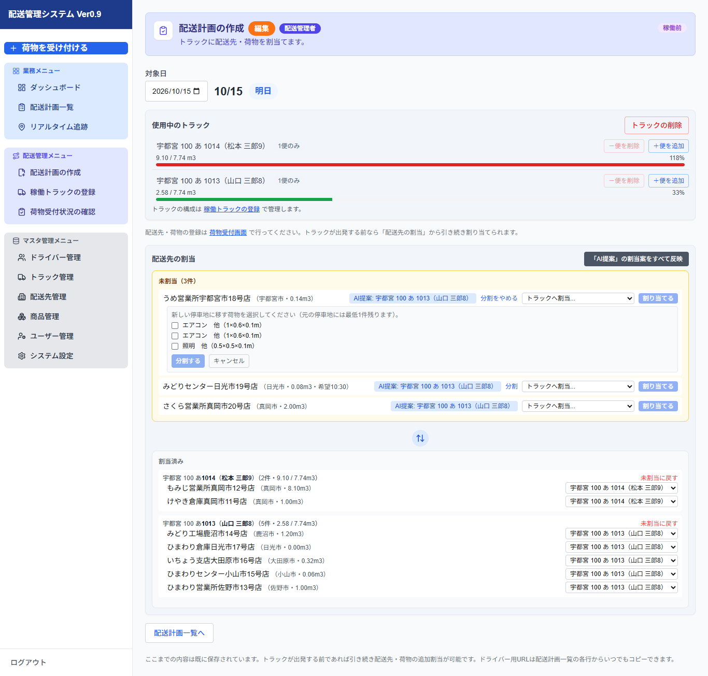

1. 「分割」を押します。
2. 新しく分ける荷物にチェックを入れます（元の配送先に最低1個は残ります）。
3. 「分割する」を押すと、同じ配送先が2件になります。それぞれ別のトラックに割り当ててください。

### 9.7 トラックを削除する

「トラックの削除」を押し、削除するトラックを選んで「削除する」を押します。割り当てていた配送先は削除されず、未割当に戻ります。出発前のトラックだけが対象です。

### 9.8 保存について

割当の操作をするたびに自動で保存されます。「保存」ボタンはありません。作業が終わったら「配送計画一覧へ」で戻ります。トラックが出発する前であれば、後から何度でも変更できます。

編集できるのは、今日から設定の日数先までの配送日です。今日の分を編集するときは注意の表示が出ます。

## 10. 稼働後ルートの編集

出発した後のトラックに、配送先を追加したり、ドライバーを変更したりする画面です。配送計画一覧で出発済みのトラックの行を押すと開きます。

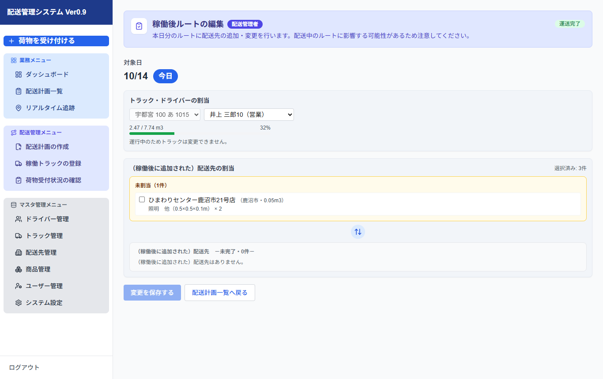

### 10.1 配送先を追加する

1. 先に「荷物受付」で、追加する配送先と荷物を登録しておきます。
2. この画面の「未割当」に、その日の未割当の配送先が表示されます。追加する配送先にチェックを入れます。
3. 「変更を保存する」を押します。

追加した場合、ドライバーは**一旦本社に戻って荷物を積み込んでから**配送に出る前提で、到着予定時刻が計算し直されます（積み込み時間は設定の値）。配送がすべて終わったトラックにも追加できます。

容積やサイズが超える場合、到着希望時刻に間に合わない場合は、保存後に注意が表示されます。

### 10.2 追加した配送先を未割当に戻す

出発した後に追加した配送先だけ、「未割当に戻す」で未割当に戻せます。出発時から積んでいた荷物は、トラックに載っているため戻せません。

### 10.3 ドライバーを変更する

「トラック・ドライバーの割当」でドライバーを選び直し、「変更を保存する」を押します。確認のメッセージが出ます。トラックは変更できません。

「変更を保存する」は、変更がある場合だけ押せます。

## 11. ドライバー用URLを送る

ドライバーは、ログインせずに専用のURLで担当ルートを開きます。

1. 配送計画一覧で、そのトラックの行の鎖の印（🔗）を押すと、URLがコピーされます。
2. メールやメッセージでドライバーに送ります。

**URLの取り扱いに注意してください。** URLを知っている人は、ログインせずにその日の担当ルートを見たり操作したりできます。URLは**配送日の当日だけ**使え、日付が変わる（日本時間の0時）と使えなくなります。

---

# 第3部 システム管理者向け

## 12. ドライバー管理

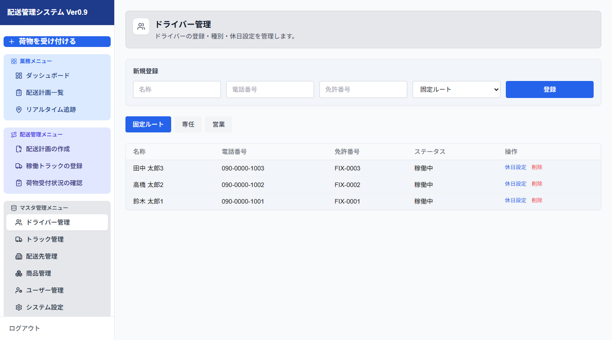

- 「固定ルート」「専任」「営業」のタブで一覧を切り替えます。
- 新規登録には、名前・電話番号・免許番号・種別が必要です。
- 「削除」を押すと、過去に配送の記録があるドライバーは「削除済み」（灰色）になり、以後は割当の候補に出なくなります。記録がなければ完全に削除されます。

### 休日を設定する

一覧の「休日設定」から、ドライバーごとの休日をカレンダーで設定します。

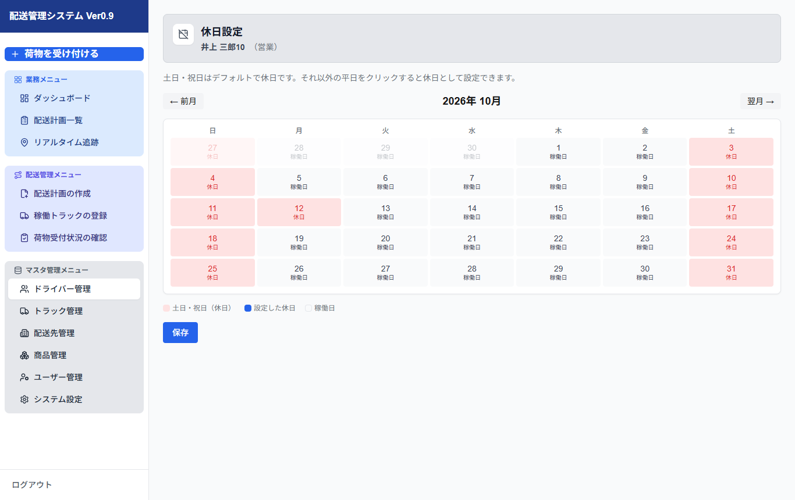

土日・祝日は自動で休日になります。それ以外に休む平日を押して選び、「保存」を押します。休日のドライバーをトラックに割り当てようとすると、警告が出ます。

## 13. トラック管理

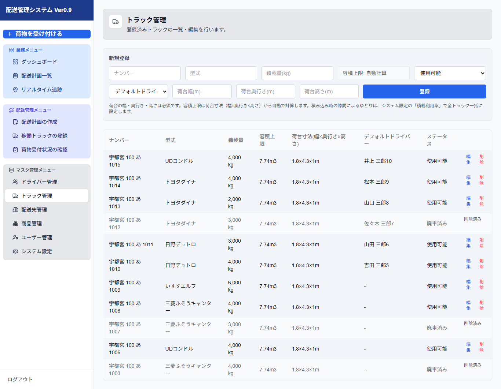

- ナンバー、型式、積載量（kg）、荷台の幅・奥行き・高さ（m）、デフォルトドライバー、状態を登録します。**荷台の幅・奥行き・高さは必須**です。
- **容積上限（m³）は自動で計算されます。** 荷台の幅・奥行き・高さを入れると、その掛け算が「容積上限」欄に表示されます（例：1.8×4.3×1＝7.74m³）。手で入力する必要はありません。
- 荷台の寸法と容積上限は、荷物の積み込み判定（荷台に入るか、どれだけ積めるか）に使います。
- 荷物の間にできる隙間を見込んだ「ゆとり」は、トラックごとではなく、システム設定の「積載利用率」で全トラックまとめて設定します（17章）。
- 積載量（kg）は登録・表示のみで、積み込みの判定には使いません。
- デフォルトドライバーは、稼働トラックの登録で自動的に入るドライバーです。
- 「削除」を押すと、過去に配送の記録があるトラックは「廃車済み」（灰色）になります。

## 14. 配送先管理

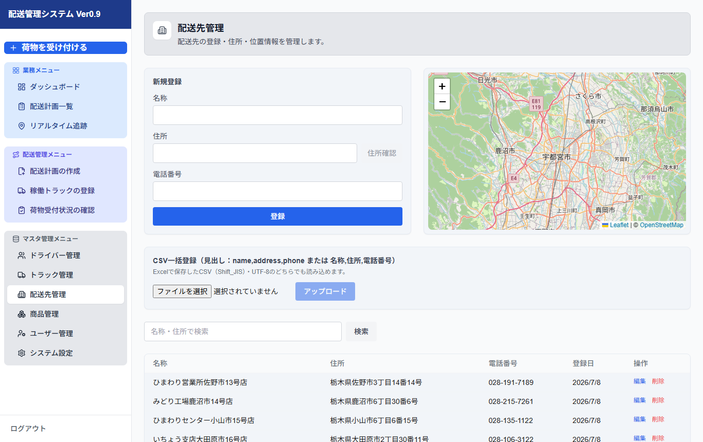

### 1件ずつ登録する

1. 名称・住所・電話番号を入力します。
2. 「住所確認」を押すと、地図に位置が表示されます。位置が正しいことを確認してください（ルートの計算に使います）。
3. 「登録」を押します。

### CSVでまとめて登録する

1. Excelなどで、1行に1件ずつ、名称・住所・電話番号を並べた表を作ります。

   | 名称 | 住所 | 電話番号 |
   |---|---|---|
   | ○○商店 | 栃木県宇都宮市本町1-1 | 028-000-0000 |

   - 1行目の見出しは「名称,住所,電話番号」でも「name,address,phone」でも構いません。見出しが無い場合は、左から名称・住所・電話番号の順として読みます。
   - 電話番号は空欄でも構いません。
2. Excelの「名前を付けて保存」で、ファイルの種類を「CSV（コンマ区切り）」にして保存します。
3. 「ファイルを選択」でそのCSVを選び、「アップロード」を押します。
4. 「成功: ○件 / 失敗: ○件」が表示されます。失敗した行は、行番号と理由が表示されます。

うまくいかないとき:

- 「ファイルを送信できませんでした…」と表示された場合は、ファイルを選んだ後にそのファイルを保存し直しています。もう一度ファイルを選んでから「アップロード」を押してください。
- 「CSVに登録するデータがありません」と表示された場合は、ファイルが空か、保存されていません。
- 住所が見つからない行は「ジオコーディング失敗」となり登録されません。住所の書き方を見直してください。

### 一覧の見方

- 住所欄には、入力した住所がそのまま表示されます。
- 住所の番地まで地図上の位置を特定できなかった配送先には、「地図上の位置は『栃木県小山市』付近（番地まで特定できませんでした）」のような注記が付きます。この配送先は、ルートの距離や到着予定時刻が、その町や市の代表地点で計算されます。「編集」で住所を「片岡2丁目2番2号」のような書き方に直すと、正しい位置になることがあります。

一覧の「編集」「削除」で変更できます。配送の記録がある配送先は削除できません。

## 15. 商品管理

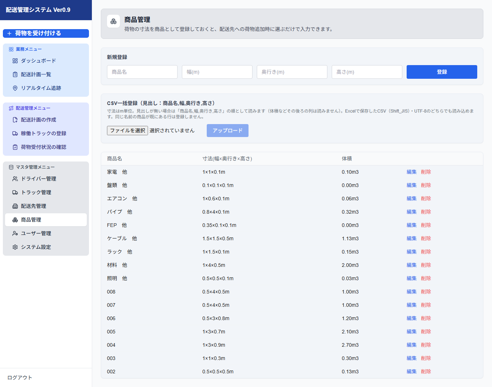

荷物受付で選ぶ商品の、名前と寸法（幅・奥行き・高さ、m）を登録します。寸法は、トラックの荷台に入るか・どれだけ場所を取るかの計算に使います。

商品を後から変更しても、すでに登録した荷物の寸法は変わりません。

### 商品を削除する

一覧の「削除」を押し、確認の画面で「削除する」を押します。

- 今日以降の、まだ配達が終わっていない荷物で使われている商品は削除できません（「本日以降の未完了の荷物（○件）で使われているため削除できません」と表示されます）。
- 過去の荷物で使われていた商品は削除できます。過去の荷物の名前と寸法はそのまま残ります。

### CSVでまとめて登録する

1. Excelなどで、1行に1件ずつ、商品名・幅・奥行き・高さ（m）を並べた表を作ります。

   | 商品名 | 幅 | 奥行き | 高さ |
   |---|---|---|---|
   | 照明　他 | 0.5 | 0.5 | 0.1 |

   - 見出しが無い場合は、左から商品名・幅・奥行き・高さの順として読みます。その右に体積などの列があっても読みません（商品マスタのExcelをそのまま使えます）。
   - 寸法は0より大きい数字（m）で入力します。
2. Excelの「名前を付けて保存」で、ファイルの種類を「CSV（コンマ区切り）」にして保存します。
3. 商品管理画面の「CSV一括登録」でそのCSVを選び、「アップロード」を押します。
4. 「成功: ○件 / 失敗: ○件」が表示されます。失敗した行は、行番号と理由が表示されます。

同じ名前の商品が既に登録されている行は、二重に登録しないよう登録されません（「既に登録されています」と表示されます）。寸法を変えたい場合は、一覧の「編集」で直してください。

## 16. ユーザー管理

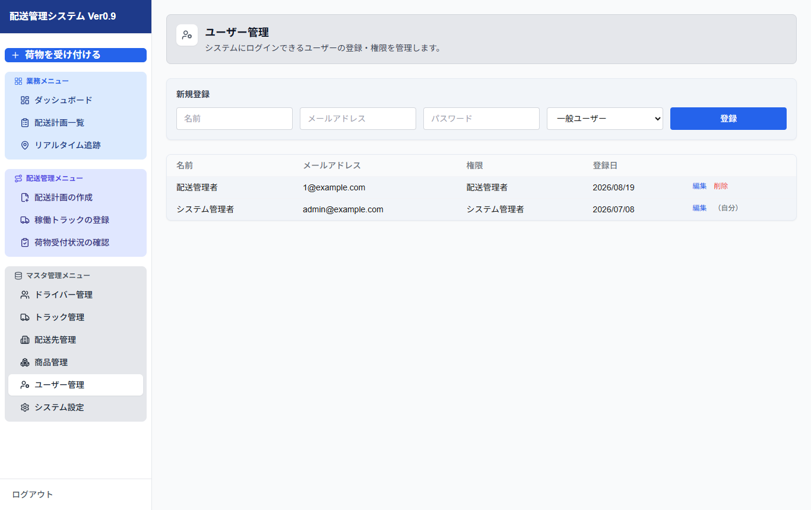

システムにログインする人を登録します。名前・メールアドレス・パスワード・権限（一般ユーザー／配送管理者／システム管理者）を入力して「登録」を押します。名前はログインに使うため、他の人と同じ名前は登録できません。

自分自身は削除できません。

## 17. システム設定

システム全体で共通の値を設定します。変更したら、下の「保存」を押してください。

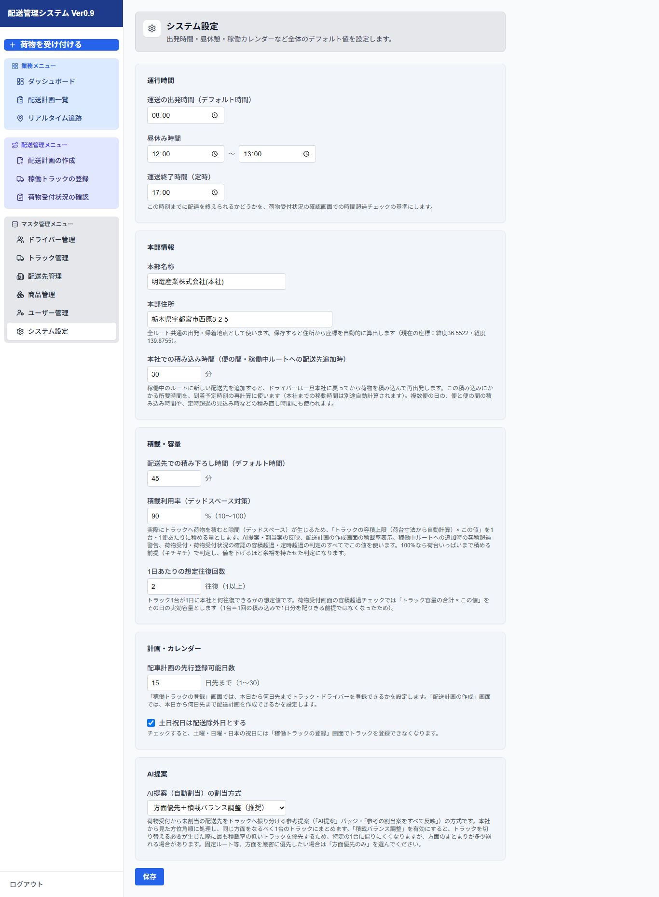

| 項目 | 内容 |
|---|---|
| 運送の出発時間 | 出発時刻を指定していないトラックの出発時刻 |
| 昼休み時間 | この時間は運転・荷下ろし・積み込みのすべてを止める前提で、到着予定時刻を計算します |
| 運送終了時間（定時） | 荷物受付・荷物受付状況の確認で、この時刻までに配りきれるかを判定します |
| 本部名称・本部住所 | 全トラックが出発・帰着する地点。住所を保存すると、地図上の位置が自動で設定されます |
| 本社での積み込み時間 | 便の間や、出発後の追加で本社に戻ったときの積み込みにかかる時間 |
| 配送先での積み下ろし時間 | 1か所あたりの荷下ろしにかかる時間 |
| 積載利用率（デッドスペース対策） | 荷物の間にできる隙間を見込み、トラックの容積上限にこの割合を掛けた量を、1台・1便あたりに積める量とします。AI提案、配送計画の作成画面の積載率、出発後の追加時の警告、荷物受付の見込みのすべてに使います。例：90%にすると、容積上限7.74m³のトラックは6.97m³までを積める量とします |
| 1日あたりの想定往復回数 | 荷物受付で、1日に運べる量を見積もるときの往復回数 |
| 配車計画の先行登録可能日数 | 稼働トラックの登録・配送計画の作成ができる、今日から何日先までか |
| 土日祝日は配送除外日とする | チェックすると、土日・祝日にトラックを登録できなくなります |
| AI提案の割当方式 | 「方面優先＋積載バランス調整（推奨）」か「方面優先のみ」 |

---

# 第4部 ドライバー向け

配送管理者から送られてきたURLを、スマートフォンのブラウザで開いて使います。ログインは不要です。

## 1. 画面を開く

- URLは**配送日の当日だけ**使えます。前日や翌日に開くと「このURLの有効期限が切れています」と表示されます。日付が変わると、配送中でも使えなくなります。
- URLは他の人に教えないでください。

## 2. 画面の見方

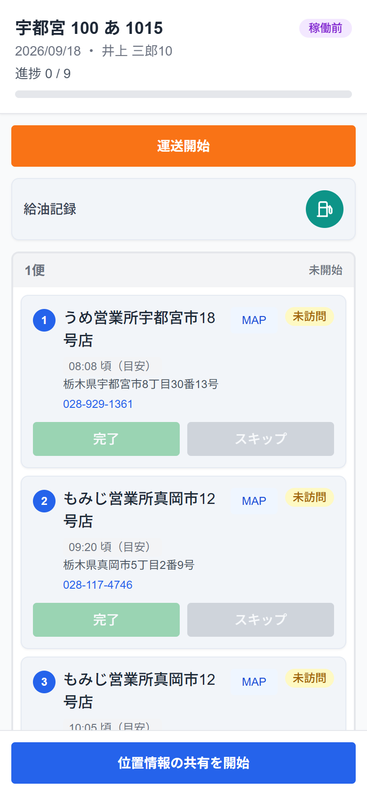

- 上に、トラックのナンバー、配送日、名前、進み具合（完了した件数／全件数）が表示されます。
- 配送先ごとに、名前、到着予定時刻、住所、電話番号が表示されます。電話番号を押すと電話をかけられます。「MAP」を押すと地図アプリで道順を確認できます。
- 到着予定時刻に「（目安）」とあるものは計算上の目安です。時刻の約束がある配送先は、目立つ表示になります。
- 1日に何度か本社に戻って積み直す日は、「1便」「2便」と便ごとに分かれて表示されます。

## 3. 運送を開始する

出発するときに「運送開始」を押します。押し忘れた場合でも、最初の配送先で「完了」を押すと、自動で開始したことになります。

## 4. 配送先ごとの操作

| ボタン | 使うとき |
|---|---|
| 完了 | 配達が終わったとき |
| スキップ | 配達できず、その配送先を飛ばすとき（荷物はトラックに残ります） |
| 取消 | 完了・スキップを押し間違えたとき（未訪問に戻ります） |

## 5. 便ごとの操作（何度か本社に戻る日）

1. 1便の配送先がすべて終わったら「この便を完了して本社へ」を押し、本社に戻ります。
2. 本社で荷物を積み込み、出発するときに「2便を開始」を押します。

まだ始まっていない便の配送先は操作できません。

## 6. 給油を記録する

給油したときは、「給油記録」の右のボタンを押します。押した時刻が記録されます。押し間違えた場合は、記録の横の「取消」で消せます。1日に何回でも記録できます。

## 7. 帰社を記録する

すべての配送先が終わり、本社に戻ったら「帰社」を押します。「◯◯:◯◯ に帰社しました」と表示されます。

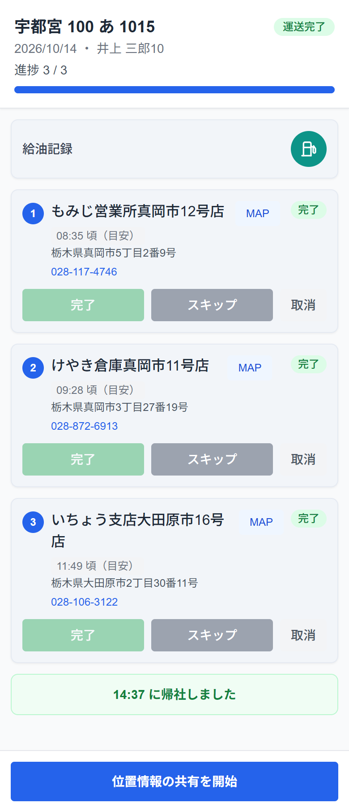

帰社した後に配送先が追加されることがあります。その場合は画面に新しい配送先が表示され、帰社の記録は取り消されます。本社で荷物を積んで、配送に出てください。

## 8. 位置情報を共有する

画面下の「位置情報の共有を開始」を押すと、現在地が本部に送られ、本部の地図にトラックの位置が表示されます。スマートフォンから位置情報の利用を求められたら「許可」を押してください。「位置情報の共有を停止」で止められます。

## 9. こんな表示が出たら

| 表示 | 意味と対応 |
|---|---|
| ルートが更新されました！内容をご確認ください | 本部が配送先や時刻を変えました。内容を確認してください |
| この配送ルートは削除されました | 本部がこの日の配送を取り消しました。配送を中止し、本部に確認してください |
| このURLの有効期限が切れています | 配送日の当日ではありません。本部に確認してください |
| （本部による操作）（本部による押下） | 押し忘れた操作を本部が代わりに行いました |

---

# 付録 用語集

## 運行状況（ダッシュボード・配送計画一覧の表示）

| 表示 | 意味 |
|---|---|
| 稼働前 | まだ出発していない |
| 運送開始 | 出発したが、まだどの配送先も終わっていない |
| 進行中 | 1件以上の配送先が終わり、配送中 |
| 運送完了 | すべての配送先が完了またはスキップ |
| 帰社途中 | すべての配送先を終え、本社へ戻っている途中（ドライバーがまだ「帰社」を押していない） |
| 帰社済み（帰社） | 配送を終えて本社に戻った |

## 配送先の状態

| 表示 | 意味 |
|---|---|
| 未訪問（未完了） | まだ完了・スキップの操作をしていない |
| 完了 | 配達した |
| スキップ | 配達できず飛ばした。荷物はトラックに残っている |

## その他の用語

| 用語 | 意味 |
|---|---|
| 未割当 | 荷物受付で登録したが、まだトラックに割り当てていない配送先 |
| 割当済み | トラックに割り当てた配送先 |
| 便 | 本社を出て、配送して本社に戻るまでの1回分。1台が1日に何便も走ることがある |
| 本社経由 | 便の区切りや出発後の追加で、本社に戻って荷物を積み込むこと |
| AI提案 | 未割当の配送先を、どのトラックに割り当てるとよいかのおすすめ。参考であり、自動では割り当てない |
| サイズ超過 | どのトラックの荷台にも、向きを変えても入らない荷物がある |
| 容積不足 | 荷台には入るが、トラックの空きが足りない |
| 容積上限 | トラックの荷台に入る体積。荷台の幅×奥行き×高さで自動計算される |
| 積載利用率 | 荷物の隙間を見込んで、容積上限のうち実際に積める割合（システム設定） |
| 積載率 | 積める量（容積上限×積載利用率）に対して、積んでいる荷物の体積の割合 |
| 到着希望時刻 | お客様と約束した到着時刻 |
| 到着予定時刻 | システムが計算した到着の見込み。移動距離と時速30kmで計算した目安 |
